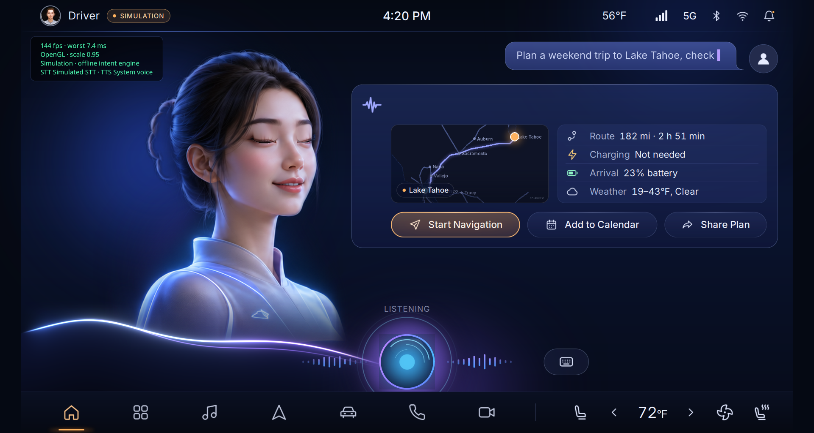
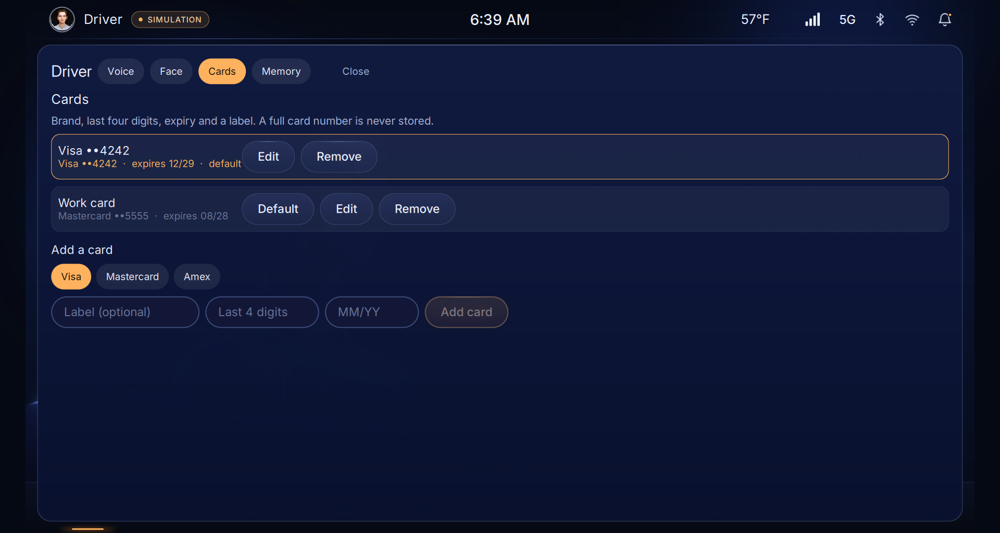

# Nova Cabin Assistant

An in-car voice assistant with a live digital-human avatar, running on a Raspberry Pi 5. Speech recognition,
speech synthesis and voice activity detection run on the device; the language model is reached through
OpenRouter.



## What it does

- **Fully on-device voice loop.** Parakeet speech recognition, Phonon speech synthesis, Silero VAD with Smart Turn
  end-of-turn detection, barge-in (talk over the assistant) and lip sync driven by the audio that is playing.
- **Echo cancellation** for the WM8960 HAT (software AEC with delay estimation) and the ReSpeaker XVF3800
  (hardware AEC, direction-of-arrival driver gating).
- **Compound requests.** "Find a coffee shop, then add a flat white and pay" is split into steps, executed in
  order and answered in one reply.
- **Live places in INR.** Mapbox-backed place search with an offline catalogue fallback, menus and prices.
- **DriveAuth payments.** Checkout approved by Voice ID, Face ID or a one-time passcode, with an encrypted wallet
  that stores only tokens, brand, last four digits and expiry.
- **Memory.** Short-term conversation summaries and a per-driver profile (home, work, preferences).
- **Telemetry and doctor.** Structured turn, tool and LLM telemetry with secret redaction, a resource sampler and a
  health check (`scripts/doctor.py`) that reports every feature and its degraded path.
- **Thermal ladder.** The avatar frame rate and the optional features step down before the Pi throttles.



## Hardware

- Raspberry Pi 5 (8 GB) with the Raspberry Pi AI HAT+ 2 (HailoRT 5.3 installed)
- A microphone and speaker path: WM8960 audio HAT, or a ReSpeaker XVF3800 USB array
- A display on a Wayland desktop session (the Pi OS default)
- Optional: Intel RealSense F455 face camera for Face ID, a USB GPS receiver

## Install

```bash
git clone git@github.com:Senthi1Kumar/nova-cabin.git
cd nova-cabin && ./setup.sh
cp .env.example .env && nano .env        # add OPENROUTER_API_KEY, then save
```

`./setup.sh` asks before it uses sudo, is safe to re-run, and finishes by running the doctor. Check the machine at any
time with:

```bash
./setup.sh --check
```

Fresh-Pi steps for the WM8960 and XVF3800 audio paths are in [INSTALL.md](INSTALL.md).

## Run

```bash
./run.sh                                  # full screen on the Pi
.venv/bin/python main.py --fullscreen     # the same, by hand
.venv/bin/python main.py --sim            # offline simulation, no keys needed
```

## Keys

Put keys in `.env` (created from `.env.example`; keep it `chmod 600`). Keys are never printed or logged.

| Key | Needed for |
|---|---|
| `OPENROUTER_API_KEY` | the language model (required for the live assistant) |
| `MAPBOX_ACCESS_TOKEN` | live places, routes and map tiles (offline catalogue without it) |
| `EXA_API_KEY` | web search through the MCP server (optional) |
| `TYPESAFE_API_KEY` | optional; reported by the doctor, not required |

## Demo script

1. "Find a coffee shop nearby." The map card lists places with distance and rating.
2. "Open the first one." The menu appears. "Add two flat whites."
3. "Check out." Approve with "yes, pay" (Voice ID), or say "use my other card".
4. While the assistant is speaking, talk over it to show barge-in.
5. "Plan a trip to Lake Tahoe and check the weather there." A compound request in one answer.
6. "Set the cabin to 70 and warm my seat."

Open the driver sheet (the avatar in the top bar) to enrol Voice ID and Face ID, manage cards and view memory.

## Troubleshooting

Run the doctor first. It lists every feature as ok, degraded or off, with the next step for each.

```bash
.venv/bin/python scripts/doctor.py
```

- No sound: check `wpctl status`, and `AUDIO_INPUT_DEVICE` / `AUDIO_OUTPUT_DEVICE` in `.env`.
- The assistant hears itself: see the echo-cancellation section of [INSTALL.md](INSTALL.md).
- Frame rate drops after a few minutes: the Pi has reached its soft thermal limit; a heatsink with a fan fixes it.
- Black window over SSH: run `./run.sh` from the desktop session, or export `XDG_RUNTIME_DIR` and
  `WAYLAND_DISPLAY=wayland-0` first.

## Licence

Licensed for evaluation. For licensing enquiries, contact Elevatics AI: info@elevatics.com
